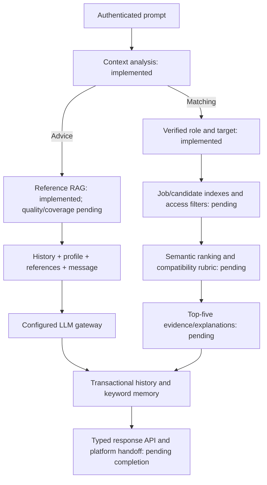

# AI scope audit and API delivery roadmap

Review date: 12 October 2026 (Africa/Tunis).

Updated with A/B implementation: see [the Agent v1 handoff](agent-api.md).

## Decision and finish line

At the initial audit, the AI MVP was **partially
implemented and not yet ready for platform integration**. The advice branch of
the supplied pipeline exists. The matching branch stops at `matching_unavailable`;
its private indexes, ranking, top-five explanations and compatibility scoring
are missing. The three `/agent/...` routes in the API specification are absent,
and canonical profile synchronization was pending. A/B now deliver typed facade
routes and synthetic candidate-offer search; real private matching, canonical
resolution/synchronization and live quality gates remain open. The audit tables
below preserve the starting evidence; the handoff document describes current APIs.

The next work should complete the Python AI service and deliver documented,
versioned APIs that the main platform can integrate. This roadmap takes precedence
for future AI work over the sequence in the 9 October improvement plan. Existing
phase documents remain historical delivery records; their phase labels overlap,
so the next increments use A-E instead of renumbering that history.

Finish line: a backend developer can authenticate a platform user, parse and
review a CV, synchronize an accepted profile, generate a reviewable pack for a
canonical offer, and run either pipeline branch through documented APIs. Candidate
search returns real accessible offers; recruiter search returns discoverable
candidates. Outputs carry source versions, evidence and explicit statuses. A
contract test suite and synthetic integration example demonstrate those flows.

## Sources and ownership

Reviewed sources:

- [Functional specification](../Cahier%20des%20Charges%20-%20Plateforme%20Emploi%20%26%20Marketplace.pdf), pages 1-3, especially sections 4 and 5.
- [Backend API specification](../APIs%20Backend.pdf), pages 1-2, especially Python endpoints and internal parsed-data synchronization.
- The attached pipeline image: context analysis, advice RAG, role-specific vector matching, prompt builders, LLM, keyword memory and response/top five.
- Current code, generated OpenAPI and offline tests. Earlier delivery reports inform the audit but do not replace current verification.

The PDFs are requirements evidence, not authorization to submit applications,
publish profiles or modify platform data during this audit. This task changes
planning documentation only.

| Owner | Responsibility |
| --- | --- |
| Python AI service | CV extraction/review drafts; completeness diagnosis; context routing; RAG; private retrieval/ranking; evidence and compatibility assessments; letters/CV adaptation drafts; AI memory; source versions; approval handoff metadata; AI API contracts. |
| Main Node.js platform | Registration/login and authoritative roles; candidate/company records; offer publication/status; application creation/status/history; direct messaging; company news; public listings/presentation; final send/publish actions. |
| Shared integration | Trusted identity propagation, canonical IDs/versions, consent/visibility, accepted-profile sync, conversation ID mapping, approved-pack handoff, score transport and fair-exposure policy. |

Marketplace, investment and virtual booths are post-MVP platform work. The
Streamlit console is a test aid; a production frontend is outside this objective.
OCR and CV layout/export remain separate decisions unless the agreed pack
contract requires an exported CV.

## Scope audit before A/B implementation

"Implemented" means repository behavior, not validated live-model quality or
compatibility with the unconnected platform.

| Requirement | Current evidence | Status / gap |
| --- | --- | --- |
| PDF to skills, experience, education and projects | `app/api/cv.py`, `app/cv/worker.py`, `app/cv/models.py`: queued text-PDF extraction, page quotes, editable facts. | Implemented locally; real-model quality pending. Scans require another source/manual entry. |
| Candidate correction/validation before publication | Exact-version correction/acceptance in `app/cv/store.py`; profile versions in `app/db/store.py`. | Implemented locally. Acceptance creates a SID profile, without canonical Node.js write-back. |
| Parsed-data/embedding synchronization | Read-only `app/platform.py`; accepted-profile outbox event. | Missing delivery adapter for `PATCH /api/v1/internal/candidate/:id/parsed-data`. Event emission is not successful sync. |
| Profile diagnosis, strengths and advice | `GET /api/v1/profiles/{profile_id}/evaluation`, `evaluate()` in `app/cv/models.py`. | Deterministic completeness/criteria/missing-field advice implemented. Not a compatibility score or measured qualitative assessment. |
| Candidate/offer/company cross-analysis | `app/dossier.py`, worker, immutable source hashes. | Partial: candidate-supplied job/company text; canonical access/version/company binding missing. |
| Personalized letter and CV optimization | Evidence matrix, editable letter, grounded `cv_suggestions`. | Implemented suggestions/letter. No adapted CV document; agree whether the API PDF's "adapte le CV" means a structured adaptation draft or export. |
| Human review before send/publication | Exact-version acceptance, evidence corrections, approvals; edits invalidate approval. | Implemented locally. Destination is not canonical-offer validated; approval records consent only. Node.js owns submission. |
| Candidate conversational offer search | Classifier selects target `offers`. | Retrieval, strict filters and real offer results missing. |
| Recruiter query/job-description sourcing | Verified role selects target `candidates`. | Retrieval, discoverability rules and structured company/job context missing. |
| Semantic matching and compatibility percentage | Reference search exposes cosine similarity and `is_compatibility_percentage: false`. | Candidate-offer scoring missing. Reference similarity/completeness cannot satisfy it. |
| Top five with explanations | Advice retrieves five references; matching returns `results: []`. | Matching results/explanations missing. Taxonomy references are not offers/candidates. |
| Received applications sorted by AI score | No application scoring integration. | AI score result contract missing; Node.js owns application listing/status. |
| Fair rotation and temporary new-record boost | No corresponding exposure/ranking policy found. | Shared requirement missing. Decide how platform public-list exposure and AI suggestions participate. |
| Optional anonymized selection | No private matching projection. | Optional/pending. If chosen, redact before prompts/ranking/results, including identifying free text; preserve consent checks. |
| Integration-ready Python APIs | 32 OpenAPI operations across 27 paths; no `/agent/...` routes. | Workflows under `/api/v1/...` exist. Facade contracts, typed outputs/errors, documented user auth and live integration missing. |

## Pipeline alignment

| Diagram stage | Current state | Completion work |
| --- | --- | --- |
| Prompt -> context agent | Schema-validated `advice` / `matching` / `clarify`; history/memory supplied. | Evaluate ambiguity/follow-ups and structured filter extraction in French/English. |
| Advice -> RAG | MongoDB/Qdrant reference retrieval, up to five hydrated results. | Reviewed guidance coverage and source/sentence-support evaluation. ESCO/ROME/O*NET/GeoNames are not live vacancies or a full coaching corpus. |
| Advice prompt -> LLM -> memory -> response | Current message, six recent turns, keywords, optional accepted profile and references; transactional turn/memory save. | Evaluate claims, injection, negation and identity leakage. Citation IDs alone do not prove factual support. |
| Matching -> user type -> target | Server-verified candidate -> offers, recruiter -> candidates. | Bind organization permissions and canonical candidate/job data. |
| Profile vector + keywords + prompt -> retrieval | No private candidate/job vector collections or combined-query strategy. | Separate rebuildable indexes, model/version metadata, profile/preferences composition and authorized hard filters. |
| Top-five retrieval -> prompt -> LLM | Matching stops before retrieval. | Rank real records, hydrate/recheck access, explain shortlisted IDs using evidence. |
| Matching memory -> response + top five | Empty results; no match-generation metadata. | Preserve atomic/idempotent turn handling; return up to five authorized records, score meaning, gaps and versions. |

The diagram names Gemini 2.0 Flash. The code uses a configurable Groq primary /
Gemini fallback gateway. Preserve this established gateway and record the model
label difference. Any model change needs account-access/quality evaluation; no
model availability or quality claim is made by this audit.

## Proposed API handoff

Expose the PDF's three `/agent/...` entry points through a thin facade over existing
services. Retain `/api/v1/...` for review, versions, polling and operations. Reuse
workers/domain logic. These are proposals, **not callable routes delivered here**.

| Target | Reused workflow | Integration contract to implement |
| --- | --- | --- |
| `POST /agent/parse-cv` | Upload/read/correct/accept `/api/v1/cv-imports` | Bounded PDF, trusted principal, language, idempotency key. 202 with import/job ID, state, polling link; then structured review draft/facts/evidence. Synchronize only the exact accepted version; expose sync separately from parse status. |
| `POST /agent/generate-pack` | `/api/v1/application-dossiers`, draft/evidence/approval/task routes | Accepted profile ID/version, canonical offer ID/version, language; server-loaded company context. 202 with draft/task IDs and polling links; then letter, adaptation draft/suggestions, evidence, source versions and review state. Never submit. |
| `POST /agent/chat` | Conversation create and `/api/v1/conversations/{id}/turns` | Message/language, existing conversation ID/revision or explicit creation behavior, verified role, idempotency. Return ID/revision, intent/target, resolved filters, typed status, answer, references or up to five real matches, provenance and memory summary. Document bounded synchronous timeouts. |

Supporting correction/acceptance/approval/polling endpoints belong in the handoff.
Agree Node.js conversation/message ID mapping: Node.js owns platform chat records;
Python owns AI processing/memory. The identical `/api/v1/conversations` prefix on
separate services must not create ambiguous routing or divergent authorities.

The received-applications module needs a scoring contract using the search rubric.
Proposed seam: authenticated `POST /agent/score-application` with canonical
candidate/profile and offer versions, returning evidence, gaps and a defined
score. This additional route is derived from the required applications score;
confirm it with the backend team or use an equivalent agreed result/event contract.
It never changes application status or makes an automatic hiring decision.

Each contract must define service authentication and authenticated-user propagation
independently; an `X-Service-Key` alone does not authorize a candidate/recruiter.
Do not trust client-declared roles or unsigned user IDs. Document request/response/
error models, language/content types, timestamps, canonical/source versions and
rubric/model provenance. Define queued/review/failed/accepted/approved/sync-pending
states as applicable, polling, deadlines, replay/conflict and retry semantics.

Cover access denial, stale versions, invalid PDF, missing configuration, retrieval
unavailability and provider failures. Align/document error shapes: current
domain-code errors and standard FastAPI validation errors differ. Preserve
`requires_human_approval` and `submitted: false` where relevant. Approval is not
delivery confirmation. Document provider data handling, log redaction and
capability-specific readiness; liveness/configuration readiness alone does not
prove matching or integration readiness.

Current OpenAPI has empty successful-response schemas on most domain routes and
only the service API-key security scheme. Runtime user checks exist; the real
user-auth contract remains undocumented. This is a client/SDK handoff gap, not
evidence that the routes permit unauthenticated access.

## Next increments and acceptance gates

### A. Freeze AI contracts and canonical integration seams

Specify facade bodies, typed outputs/errors, supporting routes and a synthetic
Node-to-Python consumer example. Resolve IDs/roles/membership/visibility fields;
specify offer/company snapshots and request/execution/approval rechecks. Design
accepted-profile sync, canonical version expectations, delivery idempotency and
conflict/retry handling. Define adaptation output and application-score transport.

Exit: contract matrix, OpenAPI schemas/examples and contract tests; synthetic
consumer happy/error/replay paths pass. External unknowns stay behind interfaces,
without fabricated login verification or permissive visibility defaults.

### B. Build searchable data and complete candidate offer search

Add separate versioned job/candidate index adapters, reusing reference-index
rebuild/fencing patterns. Main-platform records remain authoritative. Handle
create/update/close/delete/consent withdrawal and stale versions. Rehydrate access
before records enter prompts/results. Define skill/location/contract/availability
filters and composition of accepted-profile vectors, memory and current prompt.

Implement candidate offer search first. Test the PDF's Sfax web-development PFE
example, follow-up changes, multilingual aliases, junior projects, contradictory
filters, no results and retrieval failure. Return real accessible offers; fewer
than five is valid.

Exit: candidate `/agent/chat` returns up to five source-backed offers on synthetic
data; update/delete/access tests pass; profile/preferences composition documented.
Real-data enablement additionally requires verified platform contracts.

### C. Complete recruiter sourcing, explanations and scoring

Implement query/job-description sourcing for authorized organizations with consent/
discoverability checks. Define a transparent compatibility rubric with criterion
evidence, missing information and weights. Evaluate semantic aliases such as
ReactJS/frontend without inventing skills. Separate vector similarity, completeness
and compatibility: a percentage describes the rubric, not hiring-success probability.

Explain only shortlisted, retrieved IDs using source evidence. Supply the same
versioned score result to Node.js received applications. Agree fair rotation/boost
ownership, duration, eligible pool and its relationship to relevance filtering;
report relevance and exposure separately. Add anonymization only if chosen,
before ranking/prompts as well as display.

Exit: both role branches work; organization/consent/filter tests pass; negation and
missing evidence are handled; human-labelled relevance/scoring reports meet agreed
thresholds. An unresolved percentage requirement stays open, rather than being
replaced by an unrelated metric.

### D. Finish CV/pack handoff and evaluate live AI

Bind generation/approval to canonical offer/company versions. Deliver agreed CV
adaptation using accepted facts only. Implement accepted-profile sync with retry,
version-conflict and duplicate-delivery handling; parsing must not publish an
unreviewed profile. Supply an approved-pack read/handoff contract for Node.js to
revalidate sources, consent and destination immediately before its submission.

Extend the saved-output harness with intent, filters, top-five relevance,
explanation support, score consistency and exposure cases. Start with synthetic
French/English data, then actual provider outputs under the agreed budget/data
policy with recorded provenance. Obtain human labels for extraction, writing,
adaptation, advice and matching; set thresholds before comparing changes. Include
reviewed guidance coverage and memory negation/identity leakage.

Exit: accepted-version sync and pack handoff pass contract tests; source changes
invalidate stale approval; human-scored live outputs meet chosen gates. Synthetic
tests are not presented as live AI quality evidence.

### E. Prove integration readiness and deliver the API package

Run database/index/model, role-isolation and contract suites against resolved
staging contracts. Measure API/queue latency and restart/recovery for CV/pack
bursts, provider failure, index lag and retries. Add queue age/worker liveness.
Complete pilot retention/deletion, MongoDB restore and maintained dependency/
container checks in proportion to deployment.

Deliver versioned OpenAPI, endpoint matrix, curl/Postman examples, synthetic
fixtures/mock adapters, backend consumer example, API/worker startup configuration,
error/retry guide, capability report and evaluation/verification evidence.

Exit: authenticated staging candidate completes CV review/sync/pack review/offer
search; staging recruiter completes authorized sourcing; backend consumes scores
and approved packs. Without the main platform, deliver a contract-tested package
and label live integration pending. Production readiness additionally requires
operational gates. Node.js owns submission delivery/reconciliation; a Python
sender is not a prerequisite for completing the matching pipeline.

## Immediate next slice and required inputs

Start A, then B. Contract fixtures, typed facade design and synthetic search
adapters can progress while backend inputs are pending. Real private matching
stays disabled until authorization/discoverability is verified. Live evaluation
runs alongside delivery when provider/data inputs are available. C depends on
searchable data; D reuses A's contracts; E verifies the complete handoff.

Required backend inputs: repository path/URL or sanitized contracts for login/
expiry/revocation/trusted callers; ID types/roles/membership/account state;
profile ownership/version/consent and offer/company visibility/version/deletion;
parsed-data sync/version/idempotency; conversation mapping; approved-pack and score
consumption. Product inputs: fair exposure/boost policy, adapted-CV format, language/
quality thresholds, provider budget/data policy and staging test principals.
See [the integration input register](platform-integration-contract.md). Dates and
capacity estimates should follow resolved contracts and measured results.

## Verification performed for the initial audit

Base revision: `f8e6d513ad113738b519ecb9c1954a332fa4fa5e`, including existing
uncommitted implementation files on 12 October. Prior changes preserved; no
application code edited by this audit.

| Check | Result | Limit |
| --- | --- | --- |
| `.venv/Scripts/python.exe -m pytest -q`, integration opt-ins cleared | **156 passed, 100 skipped**, one upstream TestClient deprecation warning, 24.63 s. | Database/Qdrant/model and other prerequisite-gated checks skipped; not successful integration results. |
| `.venv/Scripts/ruff.exe check app tests` | Passed. | Static check. |
| `.venv/Scripts/ruff.exe format --check app tests` | Passed, 71 files formatted. | Static check. |
| `git diff --check` | Passed; CRLF conversion notices only. | Whitespace check. |
| Fresh OpenAPI with empty settings, no lifespan/services | 27 paths, 32 operations, zero `/agent/...` paths. | Schema inventory, not a live flow. |
| Saved-output evaluation CLI | Report generated; human review awaiting review, release gate not assessed. | Synthetic outputs; no live calls/human ratings. |
| Docker inventory | Unavailable: Docker Desktop Linux-engine pipe absent. | Database/index/container checks not rerun; previous delivery reports are historical evidence. |
| Source review | All PDF text extracted; functional pages 2-3/API page 2 rendered and visually reviewed with the image. | Requirements audit, not product acceptance. |

Current schema and synthetic report are in `.artifacts/scope-audit-2026-10-12/`
(ignored local evidence). Live integration/quality gates remain explicitly open.

## A/B delivery after the audit

The independent A contract work and synthetic candidate-search slice of B are
implemented. See [the API handoff](agent-api.md) for exact behavior and examples.

- Typed `/agent/parse-cv`, `/agent/generate-pack`, `/agent/chat` and service-protected
  `/agent/capabilities`; typed CV/task/core-draft polling schemas; combined service
  and verified-user authentication documentation; proposed accepted-profile sync DTO.
- Explicit synthetic offer adapter with versioned source/company bindings,
  rebuildable generation identity, location/contract/skill filters, profile/query/
  memory ranking, up to five source-backed offers and validated explanation quotes.
- Default real private matching disabled; recruiter matching unavailable. Synthetic
  opt-in is through the factory/local demo, never a user request field. Changed
  generations invalidate match replay; no matches and ambiguity are explicit.
- Exported schemas, synthetic corpus/request fixtures, a runnable consumer example
  and regression coverage of the demo's real CV/dossier workers.

The production offer resolver and profile-sync sender are not implemented. The
facade's default pack path returns `canonical_offers_not_integrated`; synthetic
packs still require candidate review and use the existing worker/version history.
Live evaluation awaits provider budget/data handling and human acceptance inputs.
Real Qdrant offer/candidate indexing, C's recruiter/rubric/exposure work, D's real
canonical handoff and E's staging/operational gates remain open.

Generated handoff schemas are in `.artifacts/agent-contracts/` and reproduced with
`python -m scripts.export_agent_contract`. Initial A/B verification passed all
276 then-collected tests. Final verification after direct-review additions:
**282 passed, no skips**, with MongoDB/Qdrant/local embeddings; Ruff and whitespace
checks passed; the rebuilt non-root read-only container passed facade/liveness
smoke checks. Details and the intermediate fixture-timeout rerun are recorded in
[the handoff verification section](agent-api.md). All generation was mocked;
live-provider and main-platform acceptance remain pending.
